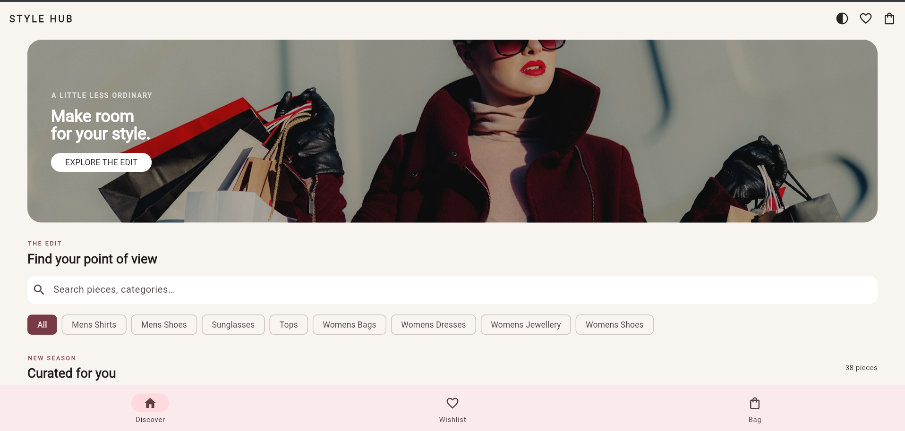
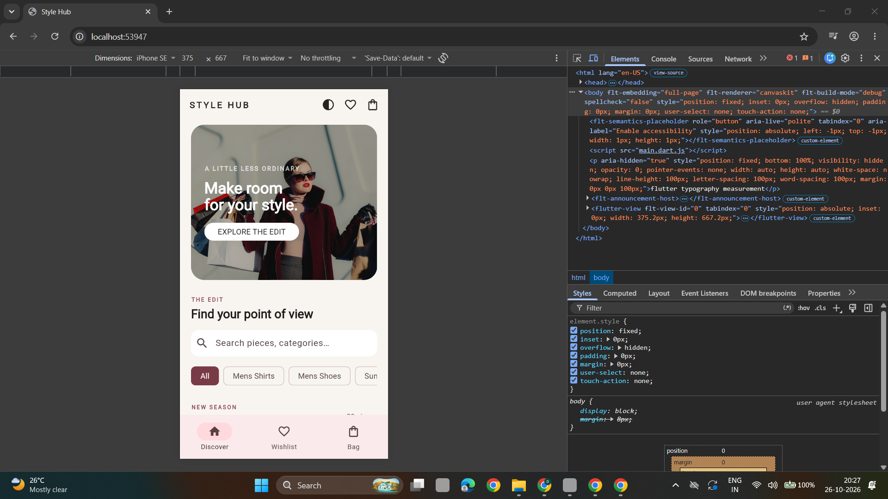

# Style Hub — Fashion Shopping Application

Style Hub is a responsive fashion-shopping application developed using Flutter and Dart for the CS506PC UI Design lab. It combines product discovery, search, category filtering, product details, wishlist management, shopping-cart calculations, checkout validation, and simulated order confirmation in one application.

The application retrieves sample fashion products from the DummyJSON API and provides a local demonstration catalog when the remote catalog cannot be loaded.

## 1. Project Objectives

- Build a responsive shopping interface using Flutter widgets.
- Demonstrate Dart fundamentals and reusable UI components.
- Implement navigation between shopping screens.
- Manage shared cart and wishlist state.
- Demonstrate form validation and error handling.
- Retrieve and parse product information from a REST API.
- Implement animations, themes, and responsive layouts.
- Verify application logic through automated tests.

## 2. Features

- Fashion product browsing and category filtering.
- Product search and product-detail screens.
- Wishlist add/remove functionality.
- Shopping cart with quantity controls and automatic total calculations.
- Checkout form with field validation.
- Simulated order confirmation without real payment processing.
- Responsive product grid and detail layouts.
- Light and dark themes.
- Loading, error, empty-state, and image-fallback handling.
- Remote product catalog with local demonstration fallback.
- Explainable, price-based Style Picks.

**Important:** Style Picks use a simple lowest-listed-price sorting rule. They are not AI-generated recommendations. Product data is provided for demonstration and does not represent guaranteed stock, discounts, ratings, or real-world availability.

## 3. Technology Stack

- **Language:** Dart
- **Framework:** Flutter
- **State management:** Provider and ChangeNotifier
- **Networking:** `http`
- **Product data:** DummyJSON REST API
- **Testing:** Flutter test framework

## 4. REST API Integration

The application requests fashion products from these DummyJSON category endpoints:

- `tops`
- `mens-shirts`
- `mens-shoes`
- `womens-dresses`
- `womens-shoes`
- `womens-bags`
- `womens-jewellery`
- `sunglasses`

The general endpoint format is:

`https://dummyjson.com/products/category/{category}`

The repository parses JSON responses into product models and combines products from the requested categories while removing duplicate IDs. Individual category failures are handled so successful category responses can still provide products. If no products can be loaded, the application can use its local demonstration catalog.

The API supplies numeric prices without a currency field, so the interface uses neutral amounts rather than assuming a particular currency.

Reference: [DummyJSON Products API](https://dummyjson.com/docs/products).

## 5. Installation and Setup

### Prerequisites

- Flutter SDK
- Dart SDK, normally included with Flutter
- Internet access for dependency resolution and remote product data
- Chrome or a configured mobile emulator/device

### Run the application

Open a terminal in the project directory and run:

```bash
flutter pub get
flutter run -d chrome
```

If platform scaffolding is missing, create the required platform folders using the appropriate Flutter setup command before running the app. Avoid regenerating existing project files unnecessarily.

### Run the Dart fundamentals demonstration

```bash
dart run tool/dart_basics.dart
```

This example demonstrates Dart variables, collections, functions, conditions, loops, and cart arithmetic.

## 6. Project Structure

```text
lib/
  main.dart
  src/
    product.dart
    catalog.dart
    shop_state.dart
    product_filters.dart
    checkout_validation.dart

test/
  style_hub_test.dart
  product_filters_test.dart
  widgets_test.dart
  catalog_test.dart
  shop_state_test.dart
  wishlist_test.dart

tool/
  dart_basics.dart

docs/
  PROJECT_REPORT_DRAFT.md
  screenshots/
    app/
    code/
```

- `main.dart` contains the application entry point, screens, navigation, themes, responsive layouts, and reusable widgets.
- `product.dart` defines product and cart-related models and the local demonstration catalog.
- `catalog.dart` handles REST requests, JSON parsing, and category aggregation.
- `shop_state.dart` manages catalog loading, cart operations, and wishlist state.
- `product_filters.dart` contains search and Style Picks filtering logic.
- `checkout_validation.dart` contains reusable checkout validation rules.
- `test/` contains automated tests for application behavior and UI elements.
- `tool/dart_basics.dart` demonstrates core Dart language concepts.

## 7. Mapping to the UI Design Lab Experiments

| Experiment | Implementation in Style Hub |
|---|---|
| 1. Dart and Flutter basics | `tool/dart_basics.dart` demonstrates typed values, functions, collections, conditions, loops, and cart arithmetic. |
| 2. Widgets and layouts | `main.dart` uses Text, Image, Container, Icon, Row, Column, Stack, product cards, and detail layouts. |
| 3. Responsive UI | LayoutBuilder, SliverLayoutBuilder, responsive product grids, and adaptive detail layouts. |
| 4. Navigation | Named routes connect home, product details, wishlist, cart, checkout, and order screens. |
| 5. State management | ChangeNotifier and Provider manage shared state; setState handles local interface interactions. |
| 6. Custom widgets and themes | Reusable product cards, product images, order totals, empty states, section headings, Style Picks, and Material 3 themes. |
| 7. Forms and validation | Checkout form validates name, email, address, and postal code fields. |
| 8. Animations | AnimatedSwitcher and eased scrolling provide interface transitions. |
| 9. REST API | `catalog.dart` retrieves product categories, parses JSON, and supports catalog failure handling. |
| 10. Testing and debugging | Automated tests cover catalog loading, cart calculations, wishlist operations, filters, validation, and widget behavior. |

## 8. Automated Testing

Run the complete test suite:

```bash
flutter test
```

Run a specific test file:

```bash
flutter test test/catalog_test.dart
flutter test test/shop_state_test.dart
flutter test test/wishlist_test.dart
```

Run static analysis:

```bash
flutter analyze
```

### Test results observed during development

- The existing Flutter test suite previously passed with **11 tests**.
- Catalog repository tests passed: **2 tests**.
- Cart state tests passed: **5 tests**.
- Wishlist tests have been added; their result should be confirmed by running the wishlist test command.
- Static analysis previously reported **13 informational lint suggestions**, with no errors reported in that run.

The results above refer to separate runs at different points in development. Run `flutter test` again after all changes to verify the complete current test suite.

## 9. Verification Status and Known Limitations

The following have been verified during the development session:

- Flutter dependency resolution completed successfully.
- The existing test suite passed with 11 tests at an earlier stage.
- The catalog repository tests passed.
- The cart state tests passed.
- Static analysis completed and reported informational lint suggestions rather than errors.

The full test suite should be rerun after the newest tests are added. Runtime appearance, responsive behavior on different screen sizes, platform builds, and genuine application screenshots should also be checked before submission.

Other limitations:

- Checkout is simulated; no payment is processed.
- The application does not provide account authentication or backend persistence.
- Product information comes from sample API data.
- Currency is unspecified by the API.
- A project report draft is available at `docs/PROJECT_REPORT_DRAFT.md`. Confirm the required college report format and generate the final document before submission.
- Capture genuine screenshots from the running application and place them in `docs/screenshots/app/`. Add code screenshots to `docs/screenshots/code/` if required by the lab instructions. Do not use mock images as evidence of actual application execution.

## 10. Screenshots and Evidence

Add screenshots of the actual running application after launching it successfully:

1. Home screen and product grid.
2. Search and category filtering.
3. Product details.
4. Wishlist.
5. Cart with quantity and total calculations.
6. Checkout validation errors.
7. Simulated order confirmation.
8. Responsive layout at different window widths.
9. Relevant source-code sections for the lab experiments.

Insert the screenshots into this README using relative Markdown image links once the image files exist. Ensure every screenshot represents the actual application.

## 11. References

- ACE Engineering College, *CS506PC: UI Design–Flutter* course plan, 2026.
- ACE Engineering College, *UI Design–Flutter Lab Manual*, 2026.
- ACE Engineering College, *One-Week Technical Project Report* template.
- [DummyJSON Products API documentation](https://dummyjson.com/docs/products).
- [Official Flutter documentation](https://docs.flutter.dev/).

---

**Project status:** Core shopping features and automated tests are implemented. Continue validating the complete test suite, run the application on a supported device or browser, capture genuine screenshots, and finalize the college report before submission.

## Application Screenshots

### 1. Style Hub Home Page — Desktop View

The desktop view demonstrates the main shopping interface, including the fashion hero banner, product search, category filters, and navigation.


### 2. Style Hub Home Page — Mobile View

The mobile view demonstrates the responsive shopping interface on a phone-sized screen, including product browsing and bottom navigation.

